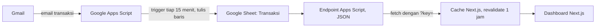

# Panduan Monitoring Keuangan

Panduan ini menjelaskan arsitektur, cara menjalankan, deploy, cache, dan troubleshooting aplikasi.

## 1. Arsitektur



- Apps Script membaca email, mengurai transaksi, lalu menulis baris ke sheet `Transaksi`.
- Endpoint Apps Script membaca sheet dan mengembalikan array JSON. Endpoint ini mengecek parameter `key`.
- Next.js mengambil JSON dari endpoint dan menyimpannya sebagai cache di server.
- Dashboard membaca dari cache, sehingga tidak memanggil Apps Script setiap halaman dibuka.

## 2. Menjalankan lokal

```powershell
cd d:\projects\duwekkunandi
npm install
```

Buat atau edit `.env.local` di root project:

```env
SHEET_API_URL=https://script.google.com/macros/s/XXXXX/exec
SHEET_API_KEY=isi-key-yang-sama-dengan-di-apps-script
APP_PIN=PIN-anda-minimal-6-digit
APP_SECRET=string-acak-dan-panjang
```

Jalankan:

```powershell
npm run dev
```

Buka `http://localhost:3000`, lalu masukkan `APP_PIN`.

Untuk membuat `APP_SECRET` yang acak, jalankan `node -e "console.log(require('crypto').randomBytes(32).toString('hex'))"`.

## 3. Deploy ke Vercel

1. Push project ke repository GitHub.
2. Di Vercel, pilih Add New, Project, lalu import repository tersebut.
3. Framework akan terdeteksi sebagai Next.js. Biarkan pengaturan build default.
4. Isi Environment Variables berikut sebelum Deploy:

| Nama | Keterangan |
|---|---|
| `SHEET_API_URL` | URL Web App Apps Script yang berakhiran `/exec` |
| `SHEET_API_KEY` | Key yang sama dengan yang dicek di Apps Script |
| `APP_PIN` | PIN login |
| `APP_SECRET` | Kunci penandatangan sesi |

5. Klik Deploy. Setelah itu, setiap push ke branch utama akan men-deploy ulang otomatis.

Jika mengubah environment variable setelah deploy, lakukan Redeploy agar nilai baru terbaca.

## 4. Cara kerja cache dan tombol Sync

- Data diambil dari endpoint dengan `cache: "no-store"` di dalam fungsi `fetchFromSheet`, lalu hasilnya dibungkus `unstable_cache` dengan kunci `transaksi-sheet`.
- Cache diberi tag `transaksi` dan masa berlaku 1 jam (`revalidate: 3600`).
- Halaman menampilkan waktu pengambilan data terakhir ("Diperbarui ...", zona WIB).
- Tombol Sync memanggil server action `syncTransaksi`, yang menjalankan `updateTag("transaksi")`. Cache langsung dibuang, lalu halaman diambil ulang dari endpoint.

Kapan data baru muncul:

1. Apps Script menulis baris baru ke sheet. Trigger berjalan tiap 15 menit.
2. Dashboard masih menampilkan cache lama selama belum kedaluwarsa (maksimal 1 jam sejak pengambilan terakhir).
3. Klik Sync untuk langsung mengambil data terbaru. Atau tunggu sampai cache kedaluwarsa, lalu buka ulang halaman.

## 5. Mengubah durasi revalidasi

Buka [src/lib/transactions.ts](../src/lib/transactions.ts) dan ubah konstanta:

```ts
export const TRANSAKSI_REVALIDATE_SECONDS = 3600;
```

Nilai dalam detik. Contoh: `900` untuk 15 menit, `86400` untuk 1 hari. Semakin kecil nilainya, semakin sering endpoint dipanggil.

## 6. Menambah kategori

1. Ubah array `KATEGORI` di Apps Script sesuai daftar kategori baru.
2. Jika ingin kategori diterapkan ke data lama, jalankan ulang fungsi kategori di Apps Script untuk baris yang sudah ada.
3. Di aplikasi, tidak perlu perubahan kode. Kategori dibaca dari kolom `kategori` di JSON.
4. Klik Sync untuk melihat hasilnya langsung.

## 7. Batas kuota dan cara mengurangi pemakaian

- Apps Script membatasi jumlah eksekusi per hari dan total waktu trigger per hari. Batas pastinya tergantung jenis akun, cek di halaman kuota Apps Script.
- Google Sheets membatasi jumlah sel dan ukuran file. Arsip data lama ke sheet lain jika sudah mendekati batas.
- Trigger tiap 15 menit sudah sekitar 96 eksekusi per hari. Naikkan interval jika kuota terasa ketat.
- Aplikasi memanggil endpoint paling sering sekali per jam per instance karena cache. Tombol Sync menambah pemanggilan, jadi gunakan seperlunya.

## 8. Troubleshooting

| Gejala | Penyebab dan solusi |
|---|---|
| Error `unauthorized` | `SHEET_API_KEY` tidak cocok dengan key di Apps Script. Samakan nilainya, lalu redeploy jika di Vercel. |
| Data tidak berubah setelah Sync | Apps Script belum di-deploy sebagai New version, atau trigger tidak berjalan. Cek Deployments dan Triggers di Apps Script, lalu cek Executions untuk error. |
| Error fetch atau HTTP 302, 404, dan sejenisnya | Pastikan `SHEET_API_URL` berakhiran `/exec` dan Web App diatur dengan akses "Anyone" (akses anonim). URL `/dev` hanya untuk tes. |
| Pesan "SHEET_API_URL atau SHEET_API_KEY belum diset" | Variabel belum ada di `.env.local` (lokal) atau di Environment Variables Vercel. |
| Kategori kosong | Kolom `kategori` di sheet kosong. Jalankan ulang fungsi kategori di Apps Script. |
| Tanggal urutannya salah | Format tanggal di sheet tidak terbaca. Gunakan `yyyy-mm-dd` untuk kolom `tanggal` dan `HH:mm` untuk `jam`. |

## 9. Keamanan

- Jangan commit `.env.local`. File ini sudah di-ignore git lewat pola `.env*`.
- Jangan membagikan `SHEET_API_KEY`, `APP_PIN`, atau `APP_SECRET` di chat, screenshot, atau repository publik.
- Endpoint Apps Script bersifat publik, jadi perlindungannya ada di `SHEET_API_KEY`. Key hanya dipakai di server, tidak dikirim ke browser.
- Jika key pernah bocor, ganti nilainya di Apps Script dan di environment aplikasi, lalu redeploy.
- Akses dashboard dilindungi PIN dengan cookie sesi httpOnly.

## Kategori penerima, transfer sendiri, dan grafik

- Kategori dari spreadsheet diabaikan. Kategori diatur di aplikasi lewat bagian **Kategori Penerima**.
- Penerima yang belum punya kategori ditandai **Baru**. Pilih kategori yang ada atau pilih **+ Kategori baru**, lalu **Simpan**.
- Penyimpanan ada di data/kategori.json (sudah di-ignore git). Di hosting serverless dengan filesystem read-only (misalnya Vercel), penyimpanan ini tidak bisa ditulis. Gunakan server dengan disk yang bisa ditulis, atau pindahkan penyimpanan ke database.
- OWNER_NAMES di .env.local berisi nama Anda, dipisah koma (contoh: OWNER_NAMES=Marvel Alfian,MARVEL). Transaksi yang penerimanya mengandung nama ini ditandai **Transfer sendiri** dan tidak dihitung di total maupun grafik.
- Grafik memakai Highcharts. Lisensinya gratis untuk penggunaan pribadi non-komersial.
